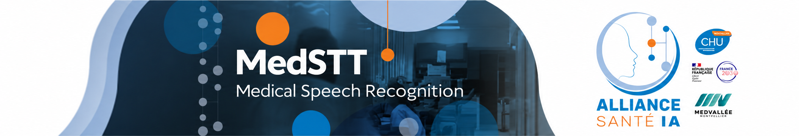

<p align="center">
  
</p>

<p align="center">
  <strong>Adapt French speech recognition to medical vocabulary.</strong><br>
  Build speech datasets, fine-tune with LoRA, and evaluate recognition quality.
</p>

<p align="center">
  <a href="https://github.com/ERIOS-project/medstt/releases/tag/v0.1.0"></a>
  <a href="https://github.com/ERIOS-project/medstt/actions/workflows/lint.yml"></a>
  <a href="#requirements"></a>
  <a href="LICENSE"></a>
</p>

<p align="center">
  <a href="#installation">Installation</a> ·
  <a href="docs/index.md">Documentation</a> ·
  <a href="docs/00-init.md">Getting started</a> ·
  <a href="docs/slurm.md">Slurm guide</a>
</p>

---

MedSTT turns medical terminology into French speech datasets and adapts
[Cohere Transcribe](https://huggingface.co/CohereLabs/cohere-transcribe-03-2026)
with decoder LoRA adapters. Built for Slurm clusters with AMD GPUs, it supports
preparing data and models before running on compute nodes without internet access.

- **Medical vocabulary:** import CIM-10, Orphanet, and local term lists, then generate sentences through an OpenAI-compatible LLM API.
- **Speech datasets:** synthesize paired train/test recordings with distinct voice descriptions using Qwen3-TTS through vLLM-Omni, and import real French speech from VoxPopuli.
- **Adaptation and evaluation:** mix synthetic and real speech for LoRA training, then compare recognition quality against the base model.
- **Resumable jobs:** shard audio generation across Slurm tasks, configure API concurrency, and follow CLI progress.

## Workflow

| Step | What happens | Output |
| --- | --- | --- |
| [00 — Initialize](docs/00-init.md) | Create the workspace and configure `medstt.yaml`. | Workspace directories and settings |
| [01 — Nomenclatures](docs/01-nomenclatures.md) | Download CIM-10 and Orphanet and normalize them into one JSONL format. | `nomenclature/normalized/*.jsonl` |
| [02 — Medical words](docs/02-words.md) | Keep, for each concept, the words that are rare in general French, with the concept as context. | `words/*.jsonl` |
| [03 — Sentences](docs/03-sentences.md) | Ask an LLM to write and validate a sentence for each term. | `sentences/*.jsonl` |
| [04 — Synthetic speech](docs/04-tts.md) | Generate one male and one female recording per sentence with Qwen3-TTS VoiceDesign. | `datasets/` (WAV files and metadata) |
| [05 — Training](docs/05-train.md) | Train decoder LoRA adapters with a duration-weighted mix of synthetic and real French speech, without validation by default. | `runs/<run_name>/final/` (adapter and processor) |
| [06 — Evaluation](docs/06-evaluate.md) | Measure three objectives against the base model: learn new words, keep them with other voice timbres, keep general French. | `evals/<name>/report.md` |

You can start with a manually prepared term list, sentence file, or audio dataset without running the preceding steps.

## Requirements

- Python 3.10–3.13.
- Linux x86_64 with a compatible AMD ROCm driver for GPU training, or macOS for local development. Check the ROCm index in `pyproject.toml` against your cluster's driver.
- Network access on the machine that imports the nomenclatures (ATIH, Orphanet).
- Access to an OpenAI-compatible LLM endpoint for sentence generation and a vLLM-Omni speech endpoint serving Qwen3-TTS VoiceDesign for audio synthesis.
- A Hugging Face account with access to the gated Cohere Transcribe model, plus a token for downloading it before offline training.

## Installation

With `uv` (recommended):

```bash
uv sync --extra train
uv run --extra train medstt --help
```

With `pip`:

```bash
python3 -m venv .venv
source .venv/bin/activate
```

On a Linux AMD cluster, install the ROCm builds first (adjust the index to match your driver):

```bash
pip install torch pytorch-triton-rocm --index-url https://download.pytorch.org/whl/rocm6.4
```

Then install the project with the training dependencies:

```bash
pip install -e '.[train]'
medstt --help
```

TTS uses the vLLM-Omni speech API from the same client environment. Install the GPU server separately in `.venv-vllm-omni`; see [TTS setup and concurrency](docs/04-tts.md). The CLI no longer loads `qwen-tts` directly.

Initialize a workspace with `uv run --extra train medstt init /path/to/workspace` (or `medstt init /path/to/workspace` in the activated `pip` environment). See the [step-by-step documentation](docs/index.md) for inputs, commands, outputs, and settings.

### Hugging Face authentication and model downloads

On the machine with internet access, request access to the [Cohere Transcribe model](https://huggingface.co/CohereLabs/cohere-transcribe-03-2026) with your Hugging Face account and create a [Hugging Face access token](https://huggingface.co/settings/tokens) with read access to the model. Export `HF_TOKEN` **before** running download commands; Hugging Face libraries read it automatically.

After either installation method above, activate the project environment and configure your workspace:

```bash
source .venv/bin/activate
export MEDSTT_WORKDIR="$HOME/medstt-ws"
medstt init "$MEDSTT_WORKDIR"
export HF_HOME="$MEDSTT_WORKDIR/cache/hf"
export HF_TOKEN="hf_your_token"

medstt model download CohereLabs/cohere-transcribe-03-2026
medstt model download Qwen/Qwen3-TTS-12Hz-1.7B-VoiceDesign
```

Replace the token placeholder locally and keep the real token out of Git. There is no Hugging Face token field in `medstt.yaml`, and MedSTT does **not** automatically load `.env` files. `MEDSTT_LLM_API_KEY` and `MEDSTT_TTS_API_KEY` authenticate requests to the LLM and TTS endpoints; they are separate from `HF_TOKEN`.

`medstt model download` always downloads to the Hugging Face cache selected by `HF_HOME` (by default, `<workspace>/cache/hf`). Keep the model's Hub ID in the configuration so it can be loaded from that cache. For an offline Slurm cluster, transfer the downloaded models and prepared datasets before submitting jobs; see [dataset preparation](docs/datasets.md) and the [Slurm guide](docs/slurm.md). The jobs enable offline mode and do not need `HF_TOKEN` when all required files are already available locally. The vLLM-Omni server must use the same model cache or a local model path.

## Development checks

### Lint and formatting

Ruff checks `src/` and `tests/` for Python errors, unused or unsorted imports, common bugs, and unnecessary complexity. It also enforces docstring style in `src/`. Its formatter checks the layout of both directories. Run the checks with:

```bash
make lint
```

To apply Ruff's safe fixes and formatting, run `make format`. The lint checks also run on pushes and pull requests through GitHub Actions.

### Tests

Run the training and pipeline tests in the training environment:

```bash
uv run --extra train pytest -q
```

The TTS API tests run in the same environment using a mocked HTTP transport:

```bash
uv run --extra train pytest -q tests/test_qwen_tts.py
```

These tests use synthetic audio, mocks, and a small Cohere model for one CPU training step. They need no GPU or downloaded model weights. The full model checkpoints, actual Qwen audio generation, and multi-GPU Slurm jobs must be checked on the target cluster.

## License and attribution

The project is developed by CHU de Montpellier and its source code is licensed under the [Apache License 2.0](LICENSE). Distributions of the project and derivative works must retain the applicable attribution in [NOTICE](NOTICE).

When citing the project in a publication or presentation, please use: **CHU de Montpellier. MedSTT — Medical Speech Recognition.** Include the [project URL](https://github.com/ERIOS-project/medstt) where possible.

## Acknowledgements

MedSTT was developed as part of the [AI2F and MINERVA hackathon at CINES](https://www.cines.fr/calcul-2/hackathon-ai2f-et-minerva-au-cines/), dedicated to AI for health and held in Montpellier on 16–18 November 2026.

We thank [CINES](https://www.cines.fr/), [AI Factory France (AI2F)](https://aifactory-france.eu/), [MINERVA](https://minerva4ai.eu/), and all the hackathon partners and HPC/AI support teams for their guidance and hands-on support in using supercomputing resources for this project.
